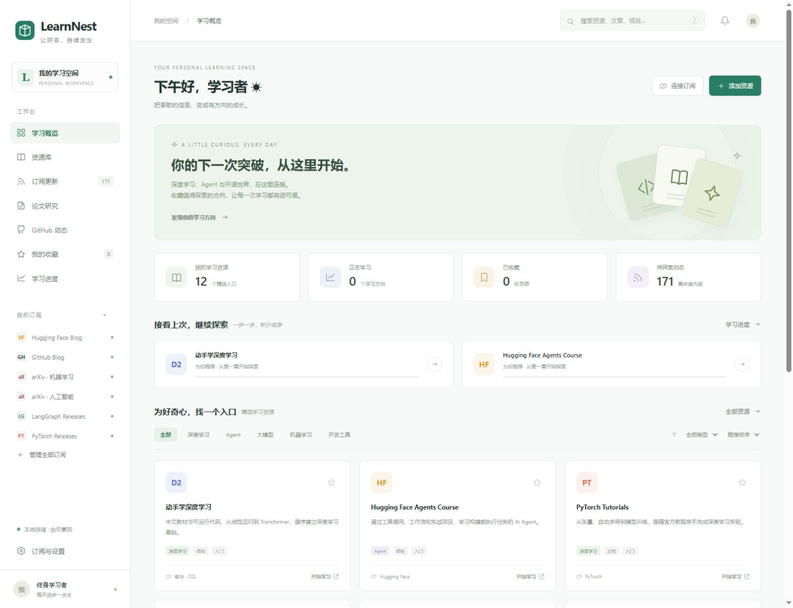

# LearnNest · AI 学习工作台

把深度学习、Agent、技术博客、研究论文和 GitHub 项目更新集中到一个本地界面。



## 启动

Windows 双击 **Start-LearnNest.cmd**。它会启动本地服务并在浏览器打开 <http://127.0.0.1:8765>。保留服务窗口即可持续自动更新；关闭窗口后停止，学习记录仍会保留。

也可以使用 Python 3.10+ 启动（不需要安装 Web 框架或数据库）：

```powershell
python -X utf8 launch.py
```

当前电脑的启动器优先使用已有的 Codex Python 运行时。复制到其他电脑时需要安装 Python。Python 的系统证书通常足够验证 HTTPS；若运行环境缺少根证书，可以安装 `certifi` 补充证书链，程序会自动检测使用。不会跳过 HTTPS 证书验证。

## 功能

- 学习概览：资源、收藏、学习进度和未读动态。
- 资源库：内置 12 个真实课程 / 文档 / 工具入口；支持添加、分类、类型筛选和搜索。
- 订阅更新：RSS 2.0、RSS 1.0、Atom；默认连接 Hugging Face、GitHub Blog、arXiv、LangGraph 和 PyTorch。
- GitHub：输入公开仓库 URL 自动转换为 Releases Atom 订阅。跟踪发布版本，不是趋势榜、Star 变化或 Issues。
- 阅读：摘要弹窗、原文跳转、已读标记和收藏。
- 学习进度：打开资源时记录为开始（5%），后续由你手动调整，完成度不自动推断。
- 订阅设置：添加、暂停、删除、立即同步、每 30 分钟自动同步。
- 数据导出：JSON，包括资源、订阅状态、缓存文章和学习记录。
- 手机宽度布局、键盘搜索快捷键 `/` 和模态弹窗。

## 数据和运行方式

SQLite 数据库保存在 `data/learnnest.sqlite3`，已排除在 Git 之外。备份时先停止服务，再复制整个 `data` 文件夹。导出的 JSON 供备份和其他工具使用，当前没有 JSON 导入界面。

服务只监听本机 `127.0.0.1`，不需要注册账号或购买订阅。运行期间后台定时获取；重启后会保留已有内容并检查是否需要更新。关闭浏览器但不停止 Python 服务，仍会继续更新。电脑关机或服务停止后不更新。

抓取需要正常网络连接，且目标站点开放订阅源。每个来源独立报告连接状态；失败时保留缓存，下次可以重试。arXiv 每日 RSS 返回空列表时，会补充查询其官方 API，获取该分类最近提交的 30 篇论文。后台获取只读取公开订阅，不上传学习数据。自定义订阅不允许访问内网、本机和非常规端口。

当前没有邮箱接入、AI 自动摘要、自动翻译、全文抓取、多设备同步、开机自启或云端部署。文章摘要由原始订阅源提供。工作台没有软件订阅费；你打开的外部课程、计算资源或未来接入的模型 API 可能另有费用。

## 开发验证

```powershell
python -m unittest discover -s tests -v
python -X utf8 diagnose_feeds.py
```

`diagnose_feeds.py` 只读取内置公开订阅并输出连接与解析状态，不修改学习记录。
